# MSOA — Microservice Shipping (port 8086)

Service REST d'**expédition et de suivi** du TP « Architecture orientée microservices : E-commerce ».
Stack : **Node.js ≥ 20 · Express 5 · SQLite (better-sqlite3)**.

## 1. Responsabilité et frontières

| Ce que Shipping **possède** | Ce que Shipping **ne fait pas** |
|---|---|
| Création d'une expédition pour une commande payée | Prix, panier, stock (Catalog / Inventory) |
| Numéro de suivi `MSOA-XXXXXXXX` | Paiement (Payments) |
| Machine à états de l'expédition | Annulation / remboursement d'une commande (Orders) |
| Sa propre base `data/shipping.db` (table `shipments`) | Lecture des bases des autres services (interdit) |

Shipping communique avec les autres services **uniquement par REST** (voir §6).

## 2. Lancement rapide

```bash
cd shipping-service
npm install
npm start            # http://localhost:8086
```

| Commande | Usage |
|---|---|
| `npm start` | Mode normal (lit `.env` ; par défaut : intégration Orders **activée**) |
| `npm run start:solo` | **Mode autonome** : aucun appel sortant, pas d'authentification — idéal pour tester Shipping seul |
| `npm run dev` | Rechargement automatique (`node --watch`) |
| `npm test` | Suite de tests automatisés (75 tests) |
| `npm run db:reset` | Supprime et recrée la base locale avec les données de démo |

Configuration : copier `.env.example` vers `.env` (Windows : `copy .env.example .env`) puis ajuster.
Toutes les variables ont une valeur par défaut ; le service démarre sans `.env`.

La base SQLite est créée automatiquement au premier démarrage (`data/shipping.db`, avec une expédition de démonstration
`order-demo-001`). Si vous préférez utiliser le fichier `shipping.db` fourni dans le TP, copiez-le dans `data/` :
il est migré automatiquement (ajout de la colonne `user_id`) sans perte de données.

**Console de test** : ouvrir <http://localhost:8086/> — liste, filtres, création, avancement des statuts, état du service.

## 3. Brancher le frontend React

Aucun composant React n'est modifié (règle du TP). Dans `src/config/backend.js` :

```javascript
const BACKEND_MODE = {
  AUTH: "mock",
  CATALOG: "mock",
  INVENTORY: "mock",
  ORDERS: "mock",
  PAYMENTS: "mock",
  SHIPPING: "rest",   // ← seule ligne à changer
};
```

Le frontend (`ShipmentTracker`, `Checkout`) utilise alors directement ce service.
CORS est configuré pour `http://localhost:5173` et `http://127.0.0.1:5173` (variable `CORS_ORIGINS`).

> **Tant qu'Orders est en mode `mock`**, lancez Shipping avec `npm run start:solo` (sinon la vérification de la
> commande échoue puisque les commandes du mode mock n'existent que dans le `localStorage` du navigateur).

## 4. Contrat REST

Format d'erreur uniforme (le frontend lit `message`) :

```json
{ "status": 409, "error": "Conflict", "message": "Invalid shipment transition: DELIVERED → SHIPPED" }
```

Une erreur de validation ajoute `details: [{ "field": "address.city", "message": "…" }]`.

### Endpoints du contrat

| Méthode | Endpoint | Succès | Erreurs |
|---|---|---|---|
| GET | `/api/shipments` | 200 `[Shipment]` (filtre `?status=`) | 400, 401 |
| GET | `/api/shipments/order/{orderId}` | 200 `Shipment` | 401, 403, **404** (aucune expédition) |
| POST | `/api/shipments` | **201** `Shipment` + `Location` | 400, 401, 403, 404, 409, 503 |
| PATCH | `/api/shipments/{id}/status` | 200 `Shipment` | 400, 401, 403, 404, 409, 502, 503 |

Endpoints complémentaires : `GET /api/shipments/{id}`, `GET /health` (public).

### Ressource `Shipment`

```json
{
  "id": "f2007528-ef62-49ef-9c0c-92aae9a23fdf",
  "orderId": "order-123",
  "address": { "name": "Demo Customer", "address": "123 Main Street", "city": "Casablanca" },
  "trackingNumber": "MSOA-73D80983",
  "status": "PREPARING",
  "createdAt": "2026-11-05T11:47:53.153Z",
  "updatedAt": "2026-11-05T11:47:53.153Z"
}
```

### Création

```bash
curl -X POST http://localhost:8086/api/shipments -H "Content-Type: application/json" \
  -d '{"orderId":"order-123","address":{"name":"Demo Customer","address":"123 Main Street","city":"Casablanca"}}'
```

Règles : `orderId` obligatoire ; `address` (`name`, `address`, `city`, ≤ 100/200/100 car.) est obligatoire, sauf si
l'intégration Orders est active — elle est alors reprise de `order.customer`. Une seule expédition par commande (409).

### Changement de statut

```bash
curl -X PATCH http://localhost:8086/api/shipments/{id}/status -H "Content-Type: application/json" -d '{"status":"SHIPPED"}'
```

## 5. États d'expédition

```
PREPARING ──► SHIPPED ──► IN_TRANSIT ──► DELIVERED
    │
    └──────► CANCELLED
```

`DELIVERED` et `CANCELLED` sont finaux. Toute autre transition (y compris vers le même statut) → **409**.
`CANCELLED` n'est possible que depuis `PREPARING` : **une expédition déjà expédiée ne peut plus être annulée**.

## 6. Communications inter-services

```mermaid
sequenceDiagram
    participant F as Frontend
    participant S as Shipping :8086
    participant O as Orders :8084
    F->>S: POST /api/shipments {orderId, address}
    S->>O: GET /api/orders/{orderId}
    O-->>S: {userId, status: PAID, customer}
    Note over S: 404 si inconnue · 409 si non PAID<br/>403 si pas le propriétaire
    S-->>F: 201 Shipment (PREPARING)
    F->>S: PATCH /api/shipments/{id}/status {SHIPPED}
    S->>O: GET /api/orders/{orderId}
    S->>O: PATCH /api/orders/{orderId}/status {SHIPPED}
    S-->>F: 200 Shipment (SHIPPED)
```



**Shipping → Orders** (appels sortants, timeout `ORDERS_TIMEOUT_MS`, header `Authorization` relayé) :

| Moment | Appel | Règle |
|---|---|---|
| Création | `GET /api/orders/{id}` | commande existante (404), statut `PAID` (409), propriétaire (403) |
| `→ SHIPPED` | `GET` puis `PATCH /api/orders/{id}/status {"status":"SHIPPED"}` | commande `PAID` (ou déjà `SHIPPED`) |
| `→ DELIVERED` | `GET` puis `PATCH … {"status":"DELIVERED"}` | commande `SHIPPED` (ou déjà `DELIVERED`) |
| `IN_TRANSIT`, `CANCELLED` | aucun | pas d'équivalent côté commande |

Orders est mis à jour **avant** l'écriture locale : si Orders refuse (409) ou est injoignable (503), l'expédition **garde
son statut** et l'appel peut être rejoué — pas d'état incohérent entre les deux services.

**Orders → Shipping** (ce qu'Orders doit appeler chez nous) : avant d'autoriser une annulation,
`GET /api/shipments/order/{orderId}` ; **404 = aucune expédition** (annulation autorisée), statut `PREPARING`/`CANCELLED` =
annulation autorisée, sinon refus. Optionnel : `PATCH /api/shipments/{id}/status {"status":"CANCELLED"}` pour annuler l'expédition.

### ⚠️ Point d'attention : double synchronisation avec le frontend

`ShipmentTracker.jsx` (non modifiable) appelle **lui aussi** `orderService.updateStatus(orderId, "SHIPPED"|"DELIVERED")`
après le PATCH vers Shipping. Comme Shipping a déjà aligné la commande, Orders reçoit un 2ᵉ PATCH vers le même statut.
Deux solutions, au choix du groupe :

1. **(recommandé)** `PATCH /api/orders/{id}/status` d'Orders est **idempotent** : même statut → `200` sans erreur ;
2. ou `ORDERS_SYNC_STATUS=false` dans `.env` : Shipping ne touche plus à la commande et laisse le frontend la synchroniser.

## 7. Sécurité

| Mesure | Détail |
|---|---|
| Authentification (`AUTH_MODE`) | `off` (dev, tokens mock) · `jwt` (signature vérifiée avec `JWT_SECRET`, claims `id`/`userId`/`sub` + `role`) · `remote` (`GET {AUTH_URL}/api/auth/me`) |
| Autorisation | Un client ne voit/modifie que **ses** expéditions (propriétaire mémorisé à la création, issu de la commande) ; `ADMIN` voit tout → **403** sinon |
| Données du frontend | Statut de la commande, propriétaire et transitions sont décidés côté serveur |
| Entrées | Validation stricte (types, longueurs, motif des identifiants), corps JSON limité à 10 ko, requêtes SQL préparées |
| En-têtes / CORS | `helmet`, CORS restreint aux origines configurées, `X-Powered-By` désactivé |
| Concurrence | Contrainte `UNIQUE(order_id)` + `UPDATE … WHERE status = ancien` (pas de double création ni de transition concurrente) |
| Erreurs | Aucune trace interne exposée (500 générique, détail dans les logs serveur) |

## 8. Structure du projet

```
shipping-service/
├── db/                 schema.sql, seed.sql
├── public/             console de test (HTML/CSS/JS, sans dépendance)
├── src/
│   ├── config/         lecture de .env
│   ├── domain/         machine à états (status.js)
│   ├── controllers/    couche HTTP (validation → service)
│   ├── services/       logique métier
│   ├── repositories/   accès SQLite
│   ├── clients/        client REST Orders
│   ├── middleware/     auth, gestion d'erreurs
│   ├── routes/ · utils/ · db/
│   ├── app.js          assemblage Express (dépendances injectables)
│   └── server.js       démarrage + arrêt propre
└── tests/              75 tests (node:test + supertest)
```

## 9. Tests et preuves

```bash
npm test
```

75 tests, 0 échec. Ils démarrent le service en mémoire, avec de **faux services Orders et Auth** (vrais serveurs HTTP).

| Critère du TP | Test(s) |
|---|---|
| Contrats REST (méthodes, chemins, JSON) | `shipments.contract` — création 201, lecture, 404, filtre, validation 400 |
| Suivi de livraison conforme aux transitions | 1 parcours nominal + 10 transitions interdites (409) + états finaux |
| Une commande expédiée ne peut plus être annulée | « commande expédiée … plus d'annulation » (`shipments.orders-integration`) |
| Cohérence expédition ↔ commande | `SHIPPED`/`DELIVERED` synchronisés ; commande annulée → 409 ; Orders en panne → 503 sans changement d'état |
| Paiement requis avant expédition | commande `PENDING_PAYMENT` / `CANCELLED` → 409 |
| Commandes associées au bon utilisateur | `shipments.auth` — 403 inter-utilisateurs, liste filtrée, admin |
| Erreurs REST correctement retournées | 400/401/403/404/409/502/503 au format uniforme |
| CORS pour le frontend Vite | préflight `PATCH` + `Authorization` |
| Concurrence | 3 `POST` simultanés → 1×201 + 2×409 |
| Base SQLite | création auto, migration du fichier du TP, contrainte `CHECK` |

Le vrai fichier `src/services/shippingService.js` du frontend a aussi été exécuté contre le service
(création, doublon 409, `PREPARING → … → DELIVERED`, transition interdite 409, 404 → `null`).

## 10. Dépannage

| Symptôme | Cause / solution |
|---|---|
| `Le port 8086 est déjà utilisé` | Changer `PORT` dans `.env` (et `API_URLS.SHIPPING` côté frontend) |
| Frontend : « Orders service is unavailable » | Orders n'est pas lancé → `npm run start:solo` ou `ORDERS_INTEGRATION=false` |
| Frontend : « Order not found » à la création | La commande n'existe pas dans Orders (mode `mock` côté frontend) → `start:solo` |
| 401 sur toutes les routes | `AUTH_MODE` ≠ `off` mais pas de token valide ; vérifier `JWT_SECRET` ou `AUTH_URL` |
| Erreur CORS dans le navigateur | Ajouter l'origine du frontend à `CORS_ORIGINS` |
| Repartir de zéro | `npm run db:reset` |
